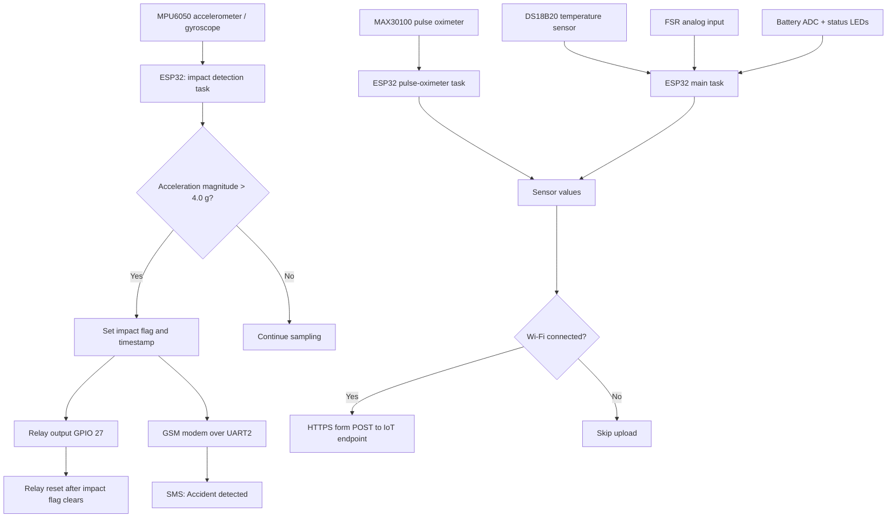

# SAFE SHIELD — Technical Design Document

## 1. Purpose and scope

This document describes the architecture represented by the supplied ESP32 prototype code. The prototype detects high acceleration magnitude, activates a relay output, sends a GSM SMS alert, reads pulse-oximeter and temperature data, samples an FSR and battery ADC input, and uploads values to an IoT endpoint.

This is a prototype design, not a certified medical or safety system. The relay should be tested with a safe dummy load, not a real airbag inflator.

## 2. Architecture diagram



## 3. Hardware interfaces

| Component | Interface | Code configuration | Role |
|---|---|---|---|
| ESP32 | MCU / FreeRTOS | Three pinned tasks | Main controller |
| MPU6050 | I²C bus 1 | SDA 21, SCL 22; address `0x68` | Acceleration sampling |
| MAX30100 | I²C default `Wire` | SDA 25, SCL 26 | Heart-rate and SpO₂ estimates |
| DS18B20-compatible sensor | OneWire | GPIO 4 | Temperature |
| GSM modem | UART2 | RX 16, TX 17, 9600 baud | SMS alert |
| Relay | Digital output | GPIO 27 | Prototype actuator output |
| FSR | ADC | GPIO 35 | Threshold-based placeholder logic |
| Battery sense | ADC | GPIO 32 | Battery status indication |
| LEDs | Digital outputs | Red 14, green 5 | Battery status indication |
| Wi-Fi / server | 2.4 GHz Wi-Fi + HTTPS POST | URL configured in sketch | Remote data upload |

Confirm the exact sensor breakout boards, voltage requirements, grounds, pull-ups, relay driver, and battery-divider circuit before powering the hardware.

## 4. Software architecture

The sketch creates three FreeRTOS tasks:

- **`Task_MPU_AccidentDetect`** (priority 2, core 1): reads MPU6050 acceleration registers, converts raw readings to g using the code's `4096.0` divisor, computes acceleration magnitude, and sets the impact flag if the magnitude exceeds `4.0 g`.
- **`Task_MAX30100`** (priority 3, core 1): calls `pox.update()` repeatedly to service the MAX30100 library.
- **`Task_MainLogic`** (priority 1, core 0): sends an SMS once per impact event, controls the relay reset, updates pulse-oximeter values, samples battery and temperature, reads the FSR, prints a serial summary, and uploads data approximately every 2 seconds when Wi-Fi is connected.

The Arduino `loop()` deletes the loop task because work is performed in FreeRTOS tasks.

## 5. Impact detection and response

1. Read raw accelerometer values from MPU6050 registers `0x3B`, `0x3D`, and `0x3F`.
2. Convert each axis to g using the divisor in the sketch.
3. Calculate magnitude: `sqrt(ax_g² + ay_g² + az_g²)`.
4. If magnitude exceeds `4.0`, set `impact_flag = 1`, set the impact timestamp, and switch the relay HIGH.
5. The flag clears after 13 seconds without a new qualifying impact.
6. The main task sends an SMS once while the flag is active, then allows another SMS after the flag clears.

**Engineering note:** This is a simple impact trigger, not a robust fall-classification algorithm. The configured MPU6050 full-scale setting and conversion divisor should be checked against the sensor datasheet and the exact library/register configuration. A safer future design should combine acceleration, orientation/angular velocity, inactivity, and a user cancellation window.

## 6. Health and auxiliary data

- **Heart rate:** accepted if the library returns 40–180 bpm; otherwise reported as zero.
- **SpO₂:** accepted if the library returns 70–100%; otherwise reported as zero.
- **Temperature:** read from the first OneWire temperature sensor.
- **FSR:** if ADC reading is at least 3800, code assigns systolic 115 and diastolic 75; otherwise both are zero. These are hard-coded placeholders and are not a blood-pressure measurement.
- **Battery:** averages five readings from GPIO 32 every 10 seconds; below 2700 turns on the red LED, otherwise the green LED.

## 7. Data flow and payload

Every 2 seconds, if Wi-Fi is connected, the sketch sends a POST request using `application/x-www-form-urlencoded`:

```text
value1=<impact_flag>
value2=<temperature_C>
value3=<heart_rate>
value4=<spo2>
value5=<systolic_placeholder>
value6=<diastolic_placeholder>
```

The endpoint must be configured to accept these fields. The code currently does not check or log the HTTP status code.

## 8. Security and reliability considerations

- Move Wi-Fi credentials, the recipient phone number, and the endpoint into a private configuration file or build secrets.
- Replace `client.setInsecure()` with server certificate validation.
- Avoid transmitting personally identifiable or health-related data without consent, appropriate security, and access controls.
- Add retry/backoff logic for Wi-Fi, HTTP, and GSM failures.
- Read and validate modem responses before reporting SMS success.
- Check sensor initialization and expose a fault status if a sensor is unavailable.
- Add timestamping, event logging, and a user cancel/acknowledge mechanism.
- Do not drive an actual airbag from this prototype without independent mechanical, electrical, and safety engineering.

## 9. Validation plan

Use the manual test cases in `../tests/TEST_CASES.md`. Begin with sensor and communication checks, then simulate the relay using an LED or low-voltage dummy load. Do not perform hazardous falls or trigger a real inflation system. Record false positives and false negatives during controlled, supervised testing.
